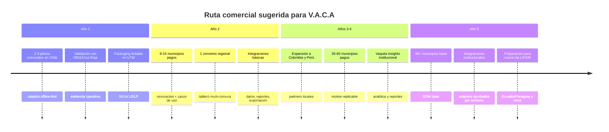

# TAM, SAM y SOM de Proyecto V.A.C.A en Chile y América Latina

## Resumen ejecutivo

Proyecto V.A.C.A no debe leerse como una “app de donaciones” en el sentido comercial tradicional. Su mercado pagador más claro es **govtech y humanitarian-tech B2G/B2B**: municipalidades, gobiernos regionales, servicios públicos, Cruz Roja/ONGs y organismos multilaterales que necesiten captura resiliente, coordinación territorial y trazabilidad operacional. La app comunitaria es gratuita y funciona como motor de adopción; el ingreso viene del **SaaS institucional**, la operación administrada, las integraciones y el soporte. Esa conclusión se apoya en tres hechos: la región sigue siendo una de las más expuestas a desastres; Chile ya opera con un aparato formal de gestión del riesgo y catastro oficial; y los compradores públicos sí pagan por sistemas, planes y plataformas de gestión del riesgo, aunque no exista una partida homogénea y visible llamada “software de emergencias”. citeturn22search4turn25search5turn39view1turn17search7turn17search12turn42view0

Mi estimación central es la siguiente. Tomando como **TAM municipal latinoamericano** un universo estructural de **15.747 gobiernos locales** en 17 países de América Latina, y aplicando un precio anual mezclado por tamaño comunal de **245,6 UTM** por entidad, el **TAM municipal base** de V.A.C.A es de aproximadamente **US$310,7 millones ARR**. Con una banda prudente de precios, el rango razonable es **US$227,7 millones a US$379,5 millones ARR**. Para Chile solo, el **TAM municipal base** es de **US$6,8 millones ARR**; al sumar capas regionales e institucionales, el mercado chileno ampliado luce más cerca de **US$8 millones a US$12 millones ARR**. Estas cifras son deliberadamente conservadoras porque ponen el foco en el SaaS municipal y tratan la capa ONG/UN, las integraciones y los servicios profesionales como extensiones, no como el núcleo del mercado. citeturn29view2turn29view3turn42view0turn19view0turn33search5turn35calculator1turn36calculator0turn35calculator2turn36calculator1turn35calculator3turn36calculator2

Para el **SAM**, el mercado realmente atendible por una startup chilena en los próximos cinco años no es “toda LATAM”, sino una primera ola con afinidad idiomática, patrón de amenazas y cercanía operativa. En este informe modelé un **SAM municipal base** compuesto por **Chile, Colombia, Perú, Ecuador y Paraguay**, que en el baseline estructural suma **3.709 gobiernos locales**. Con el mismo precio mezclado, eso da un **SAM municipal base de US$73,2 millones ARR**, con un rango prudente de **US$53,6 millones a US$89,4 millones**. Con overlays regionales, ONG y licencias analíticas, el **SAM ampliado** se ubica razonablemente alrededor de **US$60 millones a US$95 millones ARR**. La tesis detrás de ese recorte es que Chile ofrece la mejor playa de desembarco por institucionalidad, compras públicas estandarizadas y necesidad evidente de acelerar el período pre-FIBE; Colombia y Perú, a su vez, aparecen como mercados con alta recurrencia de eventos hidrometeorológicos y volumen municipal suficiente para justificar expansión temprana. citeturn29view2turn41view0turn39view1turn40view0turn40view1turn11search4turn38search13

El **SOM a cinco años**, entendido como ingreso anual realistamente capturable, depende más del ritmo de adopción pública y del tiempo de conversión piloto→contrato que del tamaño teórico del mercado. Mi modelación entrega tres salidas plausibles para el año 5: **US$0,98 millones** en un escenario conservador, **US$3,22 millones** en un escenario base y **US$8,50 millones** en un escenario agresivo. Eso equivale, aproximadamente, a capturar **1,3%**, **4,2%** y **11,2%** del SAM ampliado, respectivamente. En otras palabras: el problema de V.A.C.A no es falta de mercado; es **demostrar que acelera el catastro, mejora la calidad del dato, reduce desorden logístico y cabe dentro del proceso de compra pública**. citeturn17search7turn17search12turn38search13

La principal recomendación estratégica es concreta: vender **inteligencia, coordinación y continuidad operacional**. El wedge comercial en Chile es reducir el vacío de información previo al catastro oficial, mejorar interoperabilidad y entregar trazabilidad verificable sin atribuirse funciones estatales ni financieras. citeturn40view0turn40view1turn11search1turn11search2turn11search18turn11search7

## Cómo se estimó el mercado

### Definiciones operativas para V.A.C.A

En este informe, **TAM** es el ingreso anual recurrente máximo si todos los compradores institucionales plausibles para el producto actual de V.A.C.A contrataran la solución. Como el modelo contempla una app comunitaria gratuita, **los usuarios finales no entran como mercado pagador**. El TAM, por tanto, se define sobre municipalidades, niveles regionales y organizaciones de respuesta que pagarían por catastro, coordinación, analítica, tableros, trazabilidad y soporte de incidentes. Las integraciones y servicios administrados se tratan como **TAM adyacente** para no mezclarlos con el SaaS recurrente base. citeturn39view1turn40view0turn40view1

**SAM** es la parte del TAM que V.A.C.A puede servir con su producto y sus capacidades probables en un horizonte de cinco años. Eso exige recortar el universo por idioma, cercanía regulatoria, facilidad de venta pública, capacidad de soporte y similitud de casos de uso. Por eso el SAM que propongo no es “América Latina completa”, sino una primera ola Chile-andina/sudamericana donde el producto puede venderse en español, con despliegue offline-first y un motion comercial relativamente homogéneo. Esa reducción es consistente con la forma en que operan los sistemas nacionales de riesgo, con la dependencia de las municipalidades del proceso de compras públicas y con la realidad de que la región sigue enfrentando desastres recurrentes y crecientemente climáticos. citeturn39view1turn11search4turn38search13turn22search4turn25search5turn41view0

**SOM** es la porción del SAM que V.A.C.A podría capturar de manera realista en cinco años, usando curvas de adopción consistentes con software público de misión crítica: pilots pequeños el primer año, conversión lenta a contratos anuales, crecimiento por referencias, y alguna expansión regional a través de municipalidades ancla, asociaciones y partners humanitarios. En el SOM, el número de usuarios comunitarios importa como activador del valor del producto, pero no se monetiza directamente. Lo que sí se monetiza son contratos institucionales recurrentes, onboarding, integración y, en escenarios base/agresivos, servicios adicionales de integración y operación administrada. citeturn38search13turn10search2turn10search16

### Fórmulas usadas

Las fórmulas core del modelo son simples:

```text
ACV municipal mezclado = Σ (participación de municipios por tamaño × precio anual por tamaño)

TAM municipal = N° de gobiernos locales × ACV municipal mezclado

SAM municipal = N° de gobiernos locales en geografía servible × ACV municipal mezclado

SOM año 5 = Ingreso software + Ingreso de servicios + Ingreso de integración/operación
```

Para evitar sobreestimar, la métrica principal del reporte es **ARR potencial** y no “gasto total en emergencias”. Esto importa mucho: el hecho de que exista gasto humanitario, fondos de emergencia o bonos estatales no significa que V.A.C.A pueda capturar más que una fracción muy pequeña de ese flujo como software. Esa distinción es crítica para una startup que hoy vende coordinación y analítica, no ayuda ni custodia de fondos. citeturn8search2turn9search9turn40view0turn40view1

### Supuestos explícitos

| Variable | Valor base del modelo | Tipo | Fuente o nota |
|---|---:|---|---|
| Municipalidades en Chile | 345 | Dato observado | SINIM/Subdere 2023. citeturn42view0 |
| Ingreso municipal total Chile | CLP 7,67 billones | Dato observado | SINIM/Subdere 2023. citeturn42view0 |
| Ingreso promedio por municipio en Chile | CLP 22,23 mil millones | Derivado | Cálculo sobre SINIM. citeturn42view0turn35calculator0 |
| Universo municipal LATAM | 15.747 gobiernos locales | Proxy estructural | BID 17 países; baseline histórico para orden de magnitud, no lead list actualizada. citeturn29view2turn29view3 |
| UTM junio 2026 | CLP 71.506 | Dato observado | SII. citeturn19view0 |
| USD/CLP observado 16-jun-2026 | CLP 890,13 | Dato observado | Banco Central. citeturn33search5 |
| Precio municipal mezclado base | 245,6 UTM ≈ US$19,7k/año | Supuesto modelado | Construido con distribución municipal BID + pricing en bandas ChileCompra. citeturn29view3turn38search13 |
| Geografía SAM | Chile + Colombia + Perú + Ecuador + Paraguay | Supuesto modelado | Elegida por idioma, tamaño municipal y fit de amenazas; ítems no especificados por el usuario. |
| Capa ONG/UN/Cruz Roja | Overlay, no núcleo | Supuesto modelado | Gasto existe, pero software capture es pequeño frente al gasto de respuesta. citeturn8search2turn9search9 |
| Servicios de integración y operación | Excluidos del TAM core; incluidos como upside en base/agresivo | Supuesto modelado | Coherente con el modelo SaaS institucional y la madurez del producto. |

Dos supuestos merecen una advertencia especial. Primero, **no existe una partida pública homogénea y comparable de “presupuesto municipal de emergencias” para todo Chile** en una sola tabla equivalente al SAM de software; por eso el pricing se ancla a ingresos municipales totales, bandas de licitación y compras reales relacionadas con GRD, no a una línea contable única. Segundo, el conteo municipal regional del BID es un **proxy estructural** útil para dimensionamiento, pero no sustituye un listado 2026 país por país. Para mercado y fundraising, sirve; para pipeline comercial, no. citeturn42view0turn12search0turn12search2turn38search13

Si este análisis se transforma en deck o data room, los mejores gráficos serían: un **waterfall TAM→SAM→SOM**, un **stacked bar** por segmento comprador, una **línea de cohortes** de adopción municipal por año y un **tornado chart** para sensibilidad de precio, adopción y retrasos de procurement.

## Demanda estructural y preparación del comprador

América Latina y el Caribe sigue siendo un mercado naturalmente fértil para una infraestructura cívica post-catástrofe. Según UNDRR, entre **2000 y 2022** la región registró aproximadamente **1.534 desastres** que afectaron a **190 millones de personas**. La misma organización subraya que la región es la **segunda más propensa a desastres** a nivel global; **81%** de su población vive en ciudades; y, en la lectura de 2025, los desastres climáticos ya representan **83%** de los eventos, con pérdidas anuales esperadas de alrededor de **US$58 mil millones**. Para V.A.C.A esto importa porque un mercado de resiliencia no necesita una catástrofe “única y extraordinaria”; necesita recurrencia suficiente para que el comprador decida presupuestar coordinación y datos. La región claramente la tiene. citeturn22search4turn25search5

Ese patrón también se observa a escala sudamericana. EM-DAT/CRED reporta que entre **2000 y 2023** hubo **505 desastres hidrológicos** en Sudamérica y **10.694 fallecidos** asociados, y que Brasil, Colombia y Perú concentran la mayor ocurrencia. El dato no sólo confirma recurrencia; también apunta a dónde V.A.C.A tiene más racionalidad comercial en una segunda etapa: países donde los eventos de inundación y lluvias extremas generan compras repetidas de levantamiento de daños, priorización y coordinación. citeturn41view0

Chile, por su parte, combina exposición alta con institucionalidad relativamente madura. SENAPRED coordina el **SINAPRED**, tiene presencia en todo el territorio y opera con **16 direcciones regionales**, articulando ministerios, gobiernos regionales, municipios y comunidades. Esto es una buena noticia y una mala noticia a la vez. La buena: existe un comprador institucional identificable y un lenguaje operativo común. La mala: V.A.C.A no puede entrar prometiendo “reemplazar al Estado”, sino **enchufarse al flujo estatal** y resolver justamente el vacío pre-catastro oficial y la ejecución territorial que hoy sigue siendo lenta y fragmentada. citeturn39view1

La FIBE expresa esa realidad con mucha claridad. En Chile, beneficios oficiales recientes como el **Bono de Recuperación** de **CLP 375.000 a CLP 1.500.000** y el **Bolsillo Electrónico de Emergencia** de **50 UF** dependieron de que al hogar se le aplicara la **Ficha Básica de Emergencia**. Con la UF del 16 de junio de 2026, ese bolsillo equivale a aproximadamente **CLP 2,04 millones**. Esa evidencia muestra dos cosas: que sí existen flujos públicos relevantes asociados al daño domiciliario, y que el cuello de botella sigue siendo la identificación y clasificación formal del daño. V.A.C.A, bien posicionado, no compite contra la FIBE; compite contra el tiempo perdido antes de la FIBE y contra la opacidad logística posterior. citeturn40view0turn40view1turn34view0turn35calculator4

La disposición de compra del sector público chileno existe, aunque aparezca distribuida. Mercado Público es la plataforma de compras para **más de 850 organismos públicos**, y sus bandas de licitación muestran que un contrato govtech entre **100 y 1.000 UTM** o entre **1.000 y 5.000 UTM** cae perfectamente dentro de rangos normales de adquisición estatal. Además, en 2025 hubo compras y licitaciones oficiales directamente vinculadas a GRD: por ejemplo, SENAPRED Tarapacá licitó diagnósticos y planes comunales de reducción del riesgo en banda **2.000–5.000 UTM**, y la Municipalidad de Pozo Almonte licitó la elaboración de su plan de emergencia por obligación de la **Ley 21.364**. Esto no prueba que V.A.C.A ya tenga mercado ganado; sí prueba que el comprador chileno **ya financia software, consultoría y sistemas relacionados con GRD**. citeturn11search4turn38search13turn17search7turn17search12

En conectividad, Chile parte desde una posición favorable para el componente comunitario. La Subsecretaría de Telecomunicaciones reportó que **95,5%** de las personas usó internet en los últimos tres meses, **87,2%** usó internet móvil en teléfono o tablet y **91,2%** lo usa diariamente; incluso en zonas rurales la frecuencia diaria llegó a **89,8%**. El cuello de botella chileno, entonces, no es falta masiva de smartphone sino continuidad de red en catástrofe, entrenamiento, hábito de uso y brecha etaria. A escala regional, el problema sí es más duro: la GSMA estima que **174 millones de latinoamericanos**, equivalentes a **28%** de la población, viven en el **usage gap**, es decir, tienen cobertura pero no usan internet móvil. Eso valida la tesis **offline-first**, pero también obliga a asumir cargas reales de capacitación y activación comunitaria fuera de Chile. citeturn5search9turn5search3turn32search6

Donde el mercado B2B humanitario sí existe, hay que ser sobrio con la captura esperable. En 2025, OCHA reportó que seis países de la región tenían planes de respuesta humanitaria que cubrían **27,3 millones** de personas en necesidad, y el nuevo Fondo Humanitario Regional para América Latina y el Caribe ejecutó una primera asignación de **US$1,3 millones** en Colombia. En Chile, la IFRC movilizó en 2026 una asignación DREF de **500.000 CHF** para reforzar la respuesta a incendios. Todo eso demuestra gasto institucional real. Pero V.A.C.A no debe modelar ese monto como revenue capturable; sólo una fracción mínima pasa por presupuesto de software, data collection, coordinación y reporting. citeturn9search3turn9search9turn8search2turn8search14

## TAM, SAM y SOM para V.A.C.A

### Precio objetivo del SaaS

La mejor forma de fijar precio para V.A.C.A en Chile es en **UTM**, porque alinea la propuesta con el lenguaje natural del procurement público y permite defender un ticket acorde a bandas de licitación ya usadas por el Estado. Mi recomendación de pricing inicial es una arquitectura de tres niveles para municipalidades más dos overlays institucionales.

| SKU sugerido | Precio anual | Equivalencia aprox. | Lectura comercial |
|---|---:|---:|---|
| Municipio pequeño | 250 UTM | CLP 17,88 millones / US$20,1k | Encaja en LE; ideal para pilotos y comunas medianas |
| Municipio estándar | 500 UTM | CLP 35,75 millones / US$40,2k | Ticket defendible para comunas con GRD activa |
| Municipio metropolitano o multi-riesgo | 1.000 UTM | CLP 71,51 millones / US$80,3k | Para integración, APIs y operación multiagencia |
| Licencia regional / GORE | 2.500–5.000 UTM | US$200,8k–US$401,7k | Overlay de orquestación y analítica |
| Licencia ONG/UN/Cruz Roja | 150–400 UTM | US$12,1k–US$32,1k | Analítica, despliegues y coordinación de terreno |

Con el ingreso municipal promedio chileno de **CLP 22,23 mil millones** por municipio, los tres niveles municipales equivalen a apenas **0,08%**, **0,16%** y **0,32%** de ese ingreso promedio anual. Eso es importante: aun cuando muchos municipios son financieramente débiles, el precio no luce estructuralmente fuera de escala para una herramienta de misión crítica, siempre que el caso de uso se ancle a cumplimiento, tiempos de catastro y capacidad de respuesta. citeturn19view0turn33search5turn35calculator0turn35calculator1turn36calculator0turn35calculator2turn36calculator1turn35calculator3turn36calculator2

No obstante, el pricing no debe basarse en una supuesta “bolsa de emergencia” uniforme, porque Chile no publica una sola partida municipal comparable de ese tipo a escala nacional. SINIM sí publica ingresos y gasto agregado, y Subdere mantiene instrumentos como el PMU y su subprograma de emergencia. La consecuencia comercial es clara: V.A.C.A debe venderse contra **presupuesto municipal general**, cumplimiento normativo, inversión regional, fondos de modernización, convenios y licitaciones específicas de GRD, no contra una línea mágica de emergencia que en la práctica suele estar fragmentada. citeturn42view0turn12search0turn12search2

### Cálculo del TAM

Para el **TAM municipal base** usé el universo estructural de **15.747 gobiernos locales** en 17 países latinoamericanos del estudio BID sobre sector municipal. Luego apliqué una mezcla por tamaño de población observada en ese mismo estudio: **50,9%** de los municipios bajo 10 mil habitantes, **37,8%** entre 10 y 50 mil, **6,0%** entre 50 y 100 mil, **4,6%** entre 100 y 500 mil y **0,7%** sobre 500 mil. Sobre esa distribución monté una parrilla de precios anuales de **120 / 250 / 500 / 1.000 / 2.000 UTM**, lo que entrega un **ACV municipal mezclado de 245,6 UTM**, o aproximadamente **US$19,7 mil** al tipo de cambio observado del 16-jun-2026. citeturn29view3turn19view0turn33search5

| Métrica | Universo | Fórmula | Resultado base |
|---|---:|---|---:|
| ACV municipal mezclado | — | Σ participación × precio | 245,6 UTM ≈ US$19,7k |
| TAM municipal LATAM | 15.747 gobiernos locales | 15.747 × ACV mezclado | **US$310,7 millones ARR** |
| TAM municipal Chile | 345 municipios | 345 × ACV mezclado | **US$6,8 millones ARR** |

**Rango prudente del TAM municipal** con un blended ACV entre **180 UTM** y **300 UTM**:  
- **LATAM:** **US$227,7m – US$379,5m ARR**  
- **Chile:** **US$5,0m – US$8,3m ARR** citeturn29view2turn29view3turn42view0turn19view0turn33search5

Mi lectura es que, para pitch y fundraising, el mejor número es: **TAM core municipal LATAM ≈ US$311m ARR**, con un **TAM ampliado** de **US$320m–US$400m** si se añaden licencias regionales, ONGs y organismos de respuesta. Esa ampliación es una **suposición comercial** y no un dato censal, porque no hay un conteo armonizado 2026 de compradores regionales humanitarios comparable al universo municipal. Por eso prefiero reportar el TAM municipal como cifra principal y tratar el resto como upside.

### Cálculo del SAM

El **SAM** que propongo para cinco años incluye **Chile, Colombia, Perú, Ecuador y Paraguay**. Con el baseline del BID, ese conjunto suma **3.709 gobiernos locales**: Chile **345**, Colombia **1.119**, Perú **1.793**, Ecuador **216** y Paraguay **236**. Es un SAM grande pero defendible para una startup chilena si la expansión sigue un patrón: Chile primero, luego países andinos y vecinos de habla hispana con alta exposición y fuerte necesidad de coordinación territorial. citeturn29view2turn29view3

| Métrica | Universo | Resultado base |
|---|---:|---:|
| SAM municipal primera ola | 3.709 gobiernos locales | **US$73,2 millones ARR** |
| Rango prudente SAM municipal | mismo universo | **US$53,6m – US$89,4m ARR** |
| SAM ampliado con overlays institucionales | municipal + regiones/ONG modelados | **US$60m – US$95m ARR** |

El recorte tiene lógica comercial. Chile aporta institucionalidad, compras públicas estandarizadas y buen piso de conectividad. Colombia y Perú aparecen, además, entre los países con más ocurrencia de desastres hidrológicos en Sudamérica según EM-DAT/CRED. Ecuador y Paraguay añaden continuidad idiomática y cercanía operativa sin obligar a V.A.C.A a enfrentar, en la primera ola, la complejidad extra de Brasil ni la dispersión multi-idioma del Caribe. La decisión no pretende decir que otros países “no sirven”; sólo que el **mercado servible** no es lo mismo que el **mercado existente**. citeturn41view0turn39view1turn11search4

### Cálculo del SOM

El **SOM** se modeló como ingreso anual capturable en el año 5, no como market share instantáneo del TAM. En este tipo de software público, la secuencia normal es: piloto, evidencia, licitación, contrato anual, renovación, expansión por referencias. Por eso usé tres escenarios de adopción.

| Escenario | Municipios pagos año 5 | Regiones / overlays año 5 | ONG/UN año 5 | Ingreso año 5 |
|---|---:|---:|---:|---:|
| Conservador | 35 | 1 | 5 | **US$0,98m** |
| Base | 90 | 3 | 12 | **US$3,22m** |
| Agresivo | 220 | 7 | 25 | **US$8,50m** |

En porcentaje del **SAM ampliado**, eso equivale aproximadamente a **1,3%**, **4,2%** y **11,2%**. En porcentaje del **TAM core municipal LATAM**, equivale a ~**0,3%**, **1,0%** y **2,7%**. Es decir, incluso el escenario agresivo sigue siendo un resultado relativamente modesto frente al tamaño teórico del mercado. Eso refuerza la lectura central del informe: el principal driver de valor es la **adopción institucional validada**, no la falta de espacio comercial. citeturn38search13turn17search7turn17search12

## Proyección de ingresos y ruta comercial

### Modelo de ingresos a cinco años

Las proyecciones de abajo diferencian **software**, **servicios de implementación** y un componente de **integración y operación administrada** que crece en escenarios base/agresivo. Se trata de revenue total anual, no sólo ARR.

| Año | Conservador | Base | Agresivo |
|---|---:|---:|---:|
| Año 1 | US$82,5k | US$153,6k | US$278,3k |
| Año 2 | US$210,0k | US$604,8k | US$1,006m |
| Año 3 | US$382,5k | US$1,198m | US$2,461m |
| Año 4 | US$712,5k | US$2,105m | US$4,806m |
| Año 5 | **US$975,0k** | **US$3,217m** | **US$8,498m** |

| Escenario | Software acumulado 5 años | Servicios acumulados 5 años | Integración/operación acumulada | Total acumulado 5 años |
|---|---:|---:|---:|---:|
| Conservador | US$1,89m | US$0,47m | US$0,00m | **US$2,36m** |
| Base | US$5,89m | US$1,18m | US$0,21m | **US$7,28m** |
| Agresivo | US$14,22m | US$2,13m | US$0,70m | **US$17,05m** |

Estos números implican una empresa todavía relativamente pequeña en el año 5, incluso en el escenario base. Esa es exactamente la razón por la cual el camino debe ser disciplinado: contrato público recurrente, pocas geografías al principio, servicios de implementación como complemento y financiamiento no dilutivo para acelerar producto. Intentar escalar demasiado rápido hacia “toda LATAM” antes de cerrar procurement playbooks en Chile probablemente destruiría más valor del que crearía. citeturn38search13turn10search2turn10search16

### Go-to-market recomendado

La entrada comercial en Chile debería estructurarse en cuatro movimientos.

Primero, **pilotos con municipalidades ancla** donde exista dolor real por incendios, inundaciones o necesidad de levantar daños rápido. El argumento comercial debe ser operativo: menor tiempo entre incidente y catastro utilizable, mejor priorización, tablero para COGRID comunal, y evidencia compatible con flujo estatal. El buyer inicial no es el “área de innovación”; es quien responde o coordina emergencia, más SECPLA/TI para formalizar compra. Este enfoque conversa bien con la Ley 21.364 y con el hecho de que ya existen licitaciones comunales para planes y herramientas GRD. citeturn39view1turn17search12

Segundo, convertir esos pilotos en **productos licitables simples**, idealmente tres SKUs municipales en UTM y un paquete regional. ChileCompra publica bandas claras de licitación, y un contrato de software modular que viva en LE o LP tiene más viabilidad que una promesa ambigua de transformación total del sistema. La venta pública en Chile requiere ese pragmatismo documental. citeturn38search13turn11search4

Tercero, usar un canal híbrido con **ONGs/Cruz Roja/academia**. Herramientas como KoboToolbox, Ushahidi o Sahana están probadas para captura y coordinación humanitaria, pero suelen dejar abiertas brechas de integración con municipalidades, trazabilidad financiera y analítica territorial permanente. V.A.C.A puede usar partners de terreno para ganar legitimidad operativa y al mismo tiempo diferenciarse como infraestructura municipalizable, no sólo como herramienta de levantamiento de datos. citeturn21search0turn21search1turn20search1turn20search2turn20search15

Cuarto, después de obtener evidencia operacional, ampliar integraciones institucionales, soporte administrado y analítica. Cada nueva capacidad debe responder a una necesidad validada y preservar privacidad, interoperabilidad y autoridad institucional.

### Hoja de ruta comercial sugerida



### Potencial de grants

Chile ofrece un carril útil de financiamiento no dilutivo para infraestructura cívica. **Start-Up Chile** mantiene líneas con subsidios de **CLP 15 millones** en Build, **CLP 25 millones** en Ignite y **CLP 75 millones** en Growth. En una startup como V.A.C.A, esos instrumentos sirven mejor para costear producto, pilotos, cumplimiento y ventas tempranas que para subsidiar operación indefinidamente. La combinación razonable sería: **grant tecnológico para construir**, **pilotos cofinanciados para validar**, y **SaaS público para sostener**. citeturn23search5turn23search1turn23search3

## Riesgos, sensibilidad y próximos pasos

### Riesgos principales

El riesgo más importante no es técnico; es de **procurement y timing**. Si la venta a municipalidades se atrasa un año por presupuesto, licitación o cambio político, el ingreso del año 5 en el escenario base cae desde **US$3,22 millones** a una cifra más cercana al nivel del año 4, es decir, alrededor de **US$2,10 millones**, una reducción cercana a **35%**. El segundo riesgo es de **conversión piloto→contrato**: si el producto se percibe como útil en la crisis pero no como infraestructura permanente de GRD, quedará atrapado en pilotos y consultorías. El tercero es de **interoperabilidad y gobernanza del dato**, porque el valor de V.A.C.A sube mucho si logra convivir con procesos oficiales y no competir frontalmente contra ellos. citeturn38search13turn39view1turn40view0turn40view1

En la capa regulatoria, la **Ley 21.719** eleva la exigencia para el tratamiento de datos personales y crea la Agencia de Protección de Datos Personales; esto afecta directamente a V.A.C.A si almacena ubicación, incidentes o información de vulnerabilidad. El diseño comercial debe mantenerse como software de coordinación y trazabilidad, con finalidad, retención, derechos y contratos de encargado claramente definidos. citeturn11search1turn11search2turn11search18turn11search7

La competencia también existe, aunque fragmentada. **KoboToolbox** es fuerte en captura offline; **Ushahidi** en crowdsourcing y mapeo; **Sahana EDEN** en coordinación de ayuda; **IFRC GO** y **HDX** en información humanitaria abierta; y el propio Estado chileno ya dispone de **SENAPRED**, **SAE**, planes GRD y la **FIBE** como compuerta oficial de ayuda. La oportunidad de V.A.C.A está menos en inventar una categoría nueva que en unir piezas que hoy siguen separadas: comunidad + municipio + analítica + trazabilidad operacional. Si no articula esas piezas mejor que la suma de incumbentes, su pricing premium será difícil de defender. citeturn21search0turn20search1turn20search2turn20search15turn21search2turn21search20turn39view1turn40view0turn40view1

### Sensibilidad del escenario base

La sensibilidad del año 5 en el escenario base se mueve, sobre todo, por cantidad de municipios pagos y ACV municipal.

| Variable alterada sobre escenario base año 5 | Resultado año 5 | Cambio vs. base |
|---|---:|---:|
| Escenario base | US$3,217m | — |
| Municipios pagos -25% | US$2,623m | -18,5% |
| Municipios pagos +25% | US$3,811m | +18,5% |
| ACV municipal -20% | US$2,742m | -14,8% |
| ACV municipal +20% | US$3,692m | +14,8% |
| Sin integración/operación adicional | US$3,067m | -4,7% |
| Servicios de implementación al 10% | US$2,962m | -7,9% |
| Retraso de 12 meses en procurement | US$2,105m | -34,6% |

La lectura es directa. **El pricing importa, pero menos que la velocidad de adquisición pública**. Las extensiones no esenciales son materialmente menos importantes que lograr que las municipalidades y regiones compren, renueven y recomienden. En terminología de inversionista, el principal riesgo del modelo no es el gross margin tecnológico; es el **sales cycle de Estado**.

### Próximos pasos recomendados para validación

El siguiente ciclo de trabajo debería concentrarse en evidencia comercial, no en expandir complejidad técnica. Recomiendo cinco frentes.

Primero, levantar una **muestra chilena de 15 a 20 municipios** segmentada por tamaño, exposición y capacidad fiscal usando SINIM. La pregunta central no es “¿les gusta la idea?”, sino “¿quién firma, con qué partida, bajo qué formato y en qué mes del año?”. Segundo, construir un **benchmark sistemático de Mercado Público** para licitaciones 2023-2026 con términos como “gestión del riesgo”, “emergencia”, “catastro”, “voluntariado”, “dashboard”, “plataforma” y “planes comunales”, con el fin de observar tickets reales, adjudicatarios, plazos y organismos compradores. Tercero, ejecutar **dos o tres pilotos chilenos** con métricas duras: tiempo desde evento a mapa útil, costo por hogar evaluado, coincidencia con validación posterior y tasa de uso offline. citeturn42view0turn11search4turn38search13turn17search7turn17search12

Cuarto, cerrar un **mapa legal** sobre tratamiento de datos, interoperabilidad con sistemas oficiales y responsabilidades operacionales. Quinto, preparar financiamiento no dilutivo orientado a producto, pilotos, seguridad y evidencia comercial, con hitos separados. citeturn11search1turn11search2turn10search2turn10search16turn23search1turn23search5